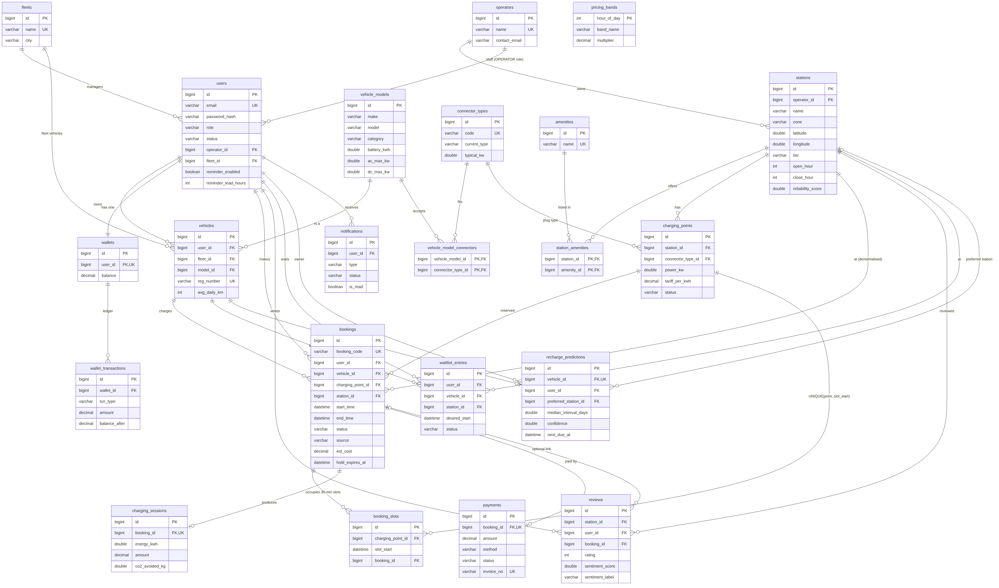
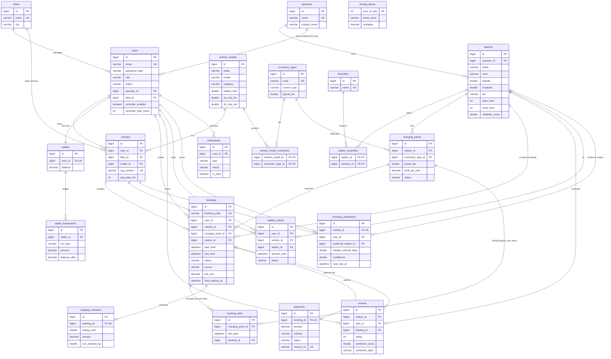
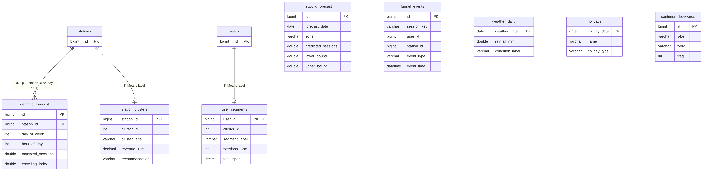
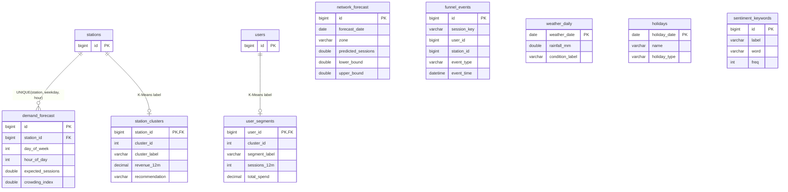
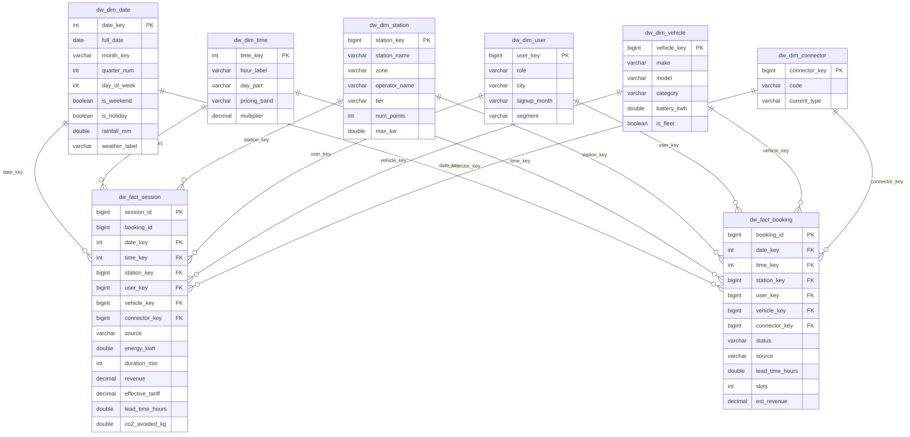
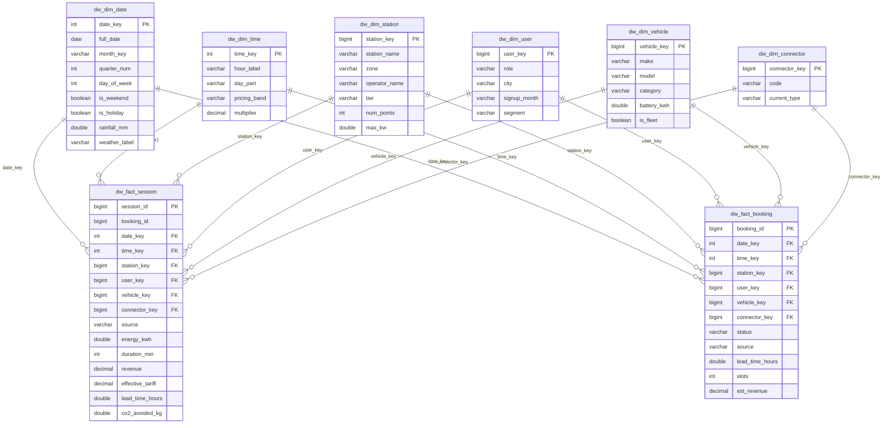

# VoltSlot - ER diagrams

Sources: `db/01_schema.sql` (operational) and `db/04_warehouse.sql` (warehouse). PNG copies (white background, readable in light and dark mode) are in `docs/img/`.
The operational database has 30 tables: 20 transactional/reference tables (diagram 1) and 10 analytics-output tables (diagram 2). The warehouse adds 8 `dw_` tables and 6 views.

## 1. Operational schema (transactional tables)





Notes
- `bookings.station_id` is deliberately denormalised (it equals the charging point's station) for fast station-level queries.
- `booking_slots` has one row per occupied 30-minute slot. `UNIQUE(charging_point_id, slot_start)` is the database-level guarantee against double booking.
- `users.operator_id` / `users.fleet_id` are nullable: only OPERATOR and FLEET_MANAGER users have them.
- Enumerations (role, status, source ...) are stored as `VARCHAR` and mapped with `@Enumerated(EnumType.STRING)`.

## 2. Analytics-output tables (written by Python, read by Spring Boot)





`pricing_bands` (diagram 1) drives dynamic off-peak pricing. `weather_daily` and `holidays` are external sources joined into `dw_dim_date`.

## 3. Warehouse star schema

Two fact tables (`dw_fact_session`: one row per charging session, `dw_fact_booking`: one row per booking) share six conformed dimensions. Natural ids are used as dimension keys. Rebuild everything with `CALL sp_refresh_warehouse();` (or Admin console, "Refresh warehouse").





Views on top of the star schema (point Metabase or Workbench at them): `v_daily_kpis`, `v_station_performance`, `v_zone_summary`, `v_hourly_heatmap`, `v_funnel_summary`, `v_segment_summary`. Twenty ready-made analytic queries are in `db/05_bi_queries.sql`.

## 4. Relationship cheat sheet

<table>
<thead><tr><th style="text-align:center"><b>Sr No</b></th><th style="text-align:center"><b>Type</b></th><th style="text-align:center"><b>Tables</b></th><th style="text-align:center"><b>How it is enforced in SQL</b></th><th style="text-align:center"><b>JPA mapping (entity class)</b></th></tr></thead>
<tbody>
<tr><td style="text-align:right">1</td><td style="text-align:left;vertical-align:top">1-1</td><td style="text-align:left;vertical-align:top">users - wallets</td><td style="text-align:left;vertical-align:top"><code>wallets.user_id</code> UNIQUE NOT NULL</td><td style="text-align:left;vertical-align:top"><code>Wallet.user</code> @OneToOne</td></tr>
<tr><td style="text-align:right">2</td><td style="text-align:left;vertical-align:top">1-1</td><td style="text-align:left;vertical-align:top">bookings - charging_sessions</td><td style="text-align:left;vertical-align:top"><code>charging_sessions.booking_id</code> UNIQUE</td><td style="text-align:left;vertical-align:top"><code>ChargingSession.booking</code> @OneToOne</td></tr>
<tr><td style="text-align:right">3</td><td style="text-align:left;vertical-align:top">1-1</td><td style="text-align:left;vertical-align:top">bookings - payments</td><td style="text-align:left;vertical-align:top"><code>payments.booking_id</code> UNIQUE</td><td style="text-align:left;vertical-align:top"><code>Payment.booking</code> @OneToOne</td></tr>
<tr><td style="text-align:right">4</td><td style="text-align:left;vertical-align:top">1-1</td><td style="text-align:left;vertical-align:top">vehicles - recharge_predictions</td><td style="text-align:left;vertical-align:top"><code>recharge_predictions.vehicle_id</code> UNIQUE</td><td style="text-align:left;vertical-align:top"><code>RechargePrediction.vehicle</code> @OneToOne</td></tr>
<tr><td style="text-align:right">5</td><td style="text-align:left;vertical-align:top">1-N</td><td style="text-align:left;vertical-align:top">operators - stations</td><td style="text-align:left;vertical-align:top"><code>stations.operator_id</code> FK</td><td style="text-align:left;vertical-align:top"><code>Station.operator</code> @ManyToOne</td></tr>
<tr><td style="text-align:right">6</td><td style="text-align:left;vertical-align:top">1-N</td><td style="text-align:left;vertical-align:top">stations - charging_points</td><td style="text-align:left;vertical-align:top"><code>charging_points.station_id</code> FK</td><td style="text-align:left;vertical-align:top"><code>ChargingPoint.station</code> @ManyToOne</td></tr>
<tr><td style="text-align:right">7</td><td style="text-align:left;vertical-align:top">1-N</td><td style="text-align:left;vertical-align:top">charging_points - booking_slots</td><td style="text-align:left;vertical-align:top">FK + <code>UNIQUE(charging_point_id, slot_start)</code></td><td style="text-align:left;vertical-align:top"><code>BookingSlot.chargingPoint</code> @ManyToOne</td></tr>
<tr><td style="text-align:right">8</td><td style="text-align:left;vertical-align:top">1-N</td><td style="text-align:left;vertical-align:top">bookings - booking_slots</td><td style="text-align:left;vertical-align:top"><code>booking_slots.booking_id</code> FK, ON DELETE CASCADE</td><td style="text-align:left;vertical-align:top"><code>BookingSlot.booking</code> @ManyToOne</td></tr>
<tr><td style="text-align:right">9</td><td style="text-align:left;vertical-align:top">N-M</td><td style="text-align:left;vertical-align:top">vehicle_models - connector_types</td><td style="text-align:left;vertical-align:top">junction <code>vehicle_model_connectors</code></td><td style="text-align:left;vertical-align:top"><code>VehicleModel.connectors</code> @ManyToMany + @JoinTable</td></tr>
<tr><td style="text-align:right">10</td><td style="text-align:left;vertical-align:top">N-M</td><td style="text-align:left;vertical-align:top">stations - amenities</td><td style="text-align:left;vertical-align:top">junction <code>station_amenities</code></td><td style="text-align:left;vertical-align:top"><code>Station.amenities</code> @ManyToMany + @JoinTable</td></tr>
</tbody>
</table>

The entities map only the owning (FK) side; the "1" side of every 1-N relation is reached by repository queries instead of a `@OneToMany` collection (no lazy-loading surprises, `open-in-view=false`).

## 5. Regenerating the PNGs

```bash
npm install -g @mermaid-js/mermaid-cli
# puppeteer config: {"executablePath":"<path to chromium>","args":["--no-sandbox"]}
mmdc -p puppeteer.json -i docs/img/src/er_core.mmd -o docs/img/er_core.png -b white -s 2 -w 1800
```
