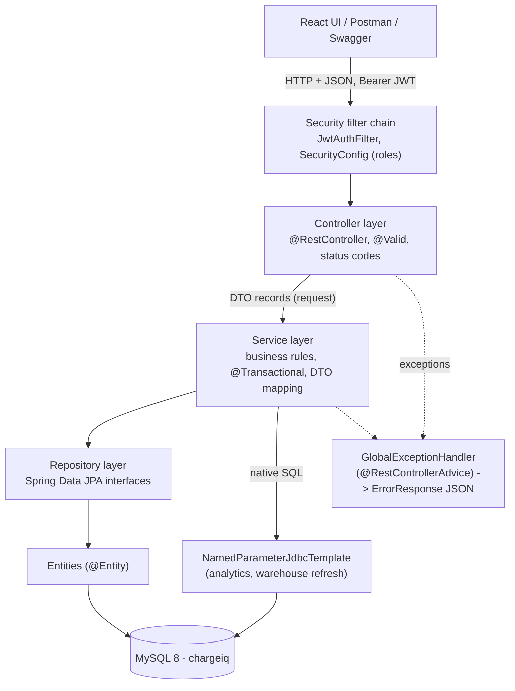
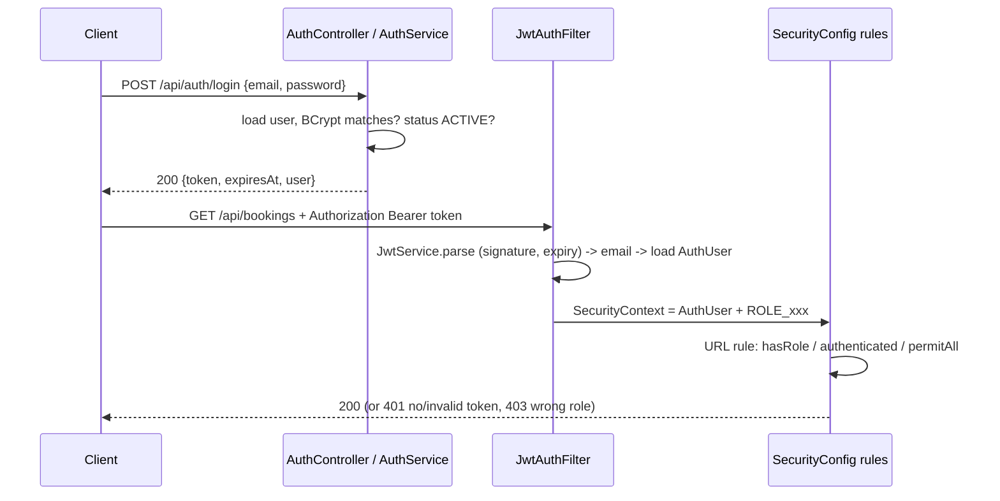

# VoltSlot - Viva notes (IP / Java FSD)

Plain-English notes for the oral exam. All paths are relative to the project root. The 12 rubric points below are the ones listed in `docs/spec/20_backend_spec.md`; check the wording against the sheet your faculty gives you.
Everything in the database is **synthetic** (seeded simulation), say so openly if asked.

## 1. Layered architecture



<table>
<thead><tr><th style="text-align:center"><b>Sr No</b></th><th style="text-align:center"><b>Layer</b></th><th style="text-align:center"><b>Package / folder</b></th><th style="text-align:center"><b>Responsibility</b></th><th style="text-align:center"><b>Example</b></th></tr></thead>
<tbody>
<tr><td style="text-align:right">1</td><td style="text-align:left;vertical-align:top">Controller</td><td style="text-align:left;vertical-align:top"><code>backend/src/main/java/com/chargeiq/controller</code></td><td style="text-align:left;vertical-align:top">Map URL + HTTP verb, validate the body with <code>@Valid</code>, choose the status code. No business logic.</td><td style="text-align:left;vertical-align:top"><code>BookingController.create</code> returns 201 + <code>Location</code> header</td></tr>
<tr><td style="text-align:right">2</td><td style="text-align:left;vertical-align:top">DTO</td><td style="text-align:left;vertical-align:top"><code>backend/src/main/java/com/chargeiq/dto</code></td><td style="text-align:left;vertical-align:top">Java <code>record</code> request/response shapes. The API never exposes entities (no password hash, no lazy proxies).</td><td style="text-align:left;vertical-align:top"><code>BookingDtos.CreateBookingRequest</code>, <code>BookingDto</code></td></tr>
<tr><td style="text-align:right">3</td><td style="text-align:left;vertical-align:top">Service</td><td style="text-align:left;vertical-align:top"><code>backend/src/main/java/com/chargeiq/service</code></td><td style="text-align:left;vertical-align:top">All rules and transactions. Maps entity to DTO inside the transaction.</td><td style="text-align:left;vertical-align:top"><code>BookingService.createHold</code>, <code>RecommendationService.recommend</code></td></tr>
<tr><td style="text-align:right">4</td><td style="text-align:left;vertical-align:top">Repository</td><td style="text-align:left;vertical-align:top"><code>backend/src/main/java/com/chargeiq/repository</code></td><td style="text-align:left;vertical-align:top">Spring Data interfaces plus a few <code>@Query</code> / <code>@Lock</code> methods.</td><td style="text-align:left;vertical-align:top"><code>ChargingPointRepository.lockByIds</code></td></tr>
<tr><td style="text-align:right">5</td><td style="text-align:left;vertical-align:top">Entity</td><td style="text-align:left;vertical-align:top"><code>backend/src/main/java/com/chargeiq/entity</code></td><td style="text-align:left;vertical-align:top">JPA classes mapped to the tables of <code>db/01_schema.sql</code>.</td><td style="text-align:left;vertical-align:top"><code>Booking</code>, <code>BookingSlot</code></td></tr>
<tr><td style="text-align:right">6</td><td style="text-align:left;vertical-align:top">Security</td><td style="text-align:left;vertical-align:top"><code>backend/src/main/java/com/chargeiq/security</code>, <code>config/SecurityConfig.java</code></td><td style="text-align:left;vertical-align:top">JWT creation / validation, role rules, 401/403 JSON.</td><td style="text-align:left;vertical-align:top"><code>JwtService</code>, <code>JwtAuthFilter</code></td></tr>
<tr><td style="text-align:right">7</td><td style="text-align:left;vertical-align:top">Exception</td><td style="text-align:left;vertical-align:top"><code>backend/src/main/java/com/chargeiq/exception</code></td><td style="text-align:left;vertical-align:top">One handler turns every error into the same JSON.</td><td style="text-align:left;vertical-align:top"><code>GlobalExceptionHandler</code></td></tr>
<tr><td style="text-align:right">8</td><td style="text-align:left;vertical-align:top">Util / clock / scheduler</td><td style="text-align:left;vertical-align:top"><code>backend/src/main/java/com/chargeiq/util</code>, <code>clock</code>, <code>scheduler</code></td><td style="text-align:left;vertical-align:top">Pure helpers, the demo clock, background jobs.</td><td style="text-align:left;vertical-align:top"><code>GeoUtil</code>, <code>AppClock</code>, <code>JobScheduler</code></td></tr>
</tbody>
</table>

## 2. The 12 IP rubric points mapped to code

<table>
<thead><tr><th style="text-align:center"><b>Sr No</b></th><th style="text-align:center"><b>Rubric point</b></th><th style="text-align:center"><b>Where to show it</b></th><th style="text-align:center"><b>What to say</b></th></tr></thead>
<tbody>
<tr><td style="text-align:right">1</td><td style="text-align:left;vertical-align:top">1. Concept / problem statement</td><td style="text-align:left;vertical-align:top"><code>README.md</code>, <code>docs/PBL_FEATURE_LIST.md</code></td><td style="text-align:left;vertical-align:top">Finding a free, cheap, compatible charger is hard; VoltSlot predicts crowding, recommends with reasons, books conflict-free slots and reminds you before the battery runs low.</td></tr>
<tr><td style="text-align:right">2</td><td style="text-align:left;vertical-align:top">2. Spring Boot project structure</td><td style="text-align:left;vertical-align:top"><code>backend/pom.xml</code>, <code>backend/src/main/java/com/chargeiq/ChargeIqApplication.java</code>, <code>backend/src/main/resources/application.properties</code></td><td style="text-align:left;vertical-align:top">Spring Boot 3.3.5 parent, starters (web, data-jpa, security, validation), packages by layer, all settings overridable by environment variables.</td></tr>
<tr><td style="text-align:right">3</td><td style="text-align:left;vertical-align:top">3. CRUD operations</td><td style="text-align:left;vertical-align:top"><code>VehicleController</code>/<code>VehicleService</code> (full CRUD), <code>OperatorController</code> (stations, points), <code>WaitlistController</code>, <code>AdminController</code> (users)</td><td style="text-align:left;vertical-align:top">Vehicles: POST 201, GET, PUT, DELETE 204 with 409 when it has bookings.</td></tr>
<tr><td style="text-align:right">4</td><td style="text-align:left;vertical-align:top">4. MySQL + Spring Data JPA</td><td style="text-align:left;vertical-align:top"><code>db/01_schema.sql</code>, <code>backend/src/main/java/com/chargeiq/repository/*</code>, <code>application.properties</code> (<code>ddl-auto=none</code>)</td><td style="text-align:left;vertical-align:top">The schema is owned by SQL scripts; Hibernate only maps. Derived queries, <code>@Query</code>, pagination.</td></tr>
<tr><td style="text-align:right">5</td><td style="text-align:left;vertical-align:top">5. Entity relationships (1-1, 1-N, N-1, N-M)</td><td style="text-align:left;vertical-align:top"><code>backend/src/main/java/com/chargeiq/entity/*</code>, see section 3</td><td style="text-align:left;vertical-align:top">Wallet 1-1 User, Station N-1 Operator, Station N-M Amenity, VehicleModel N-M ConnectorType.</td></tr>
<tr><td style="text-align:right">6</td><td style="text-align:left;vertical-align:top">6. REST design + status codes</td><td style="text-align:left;vertical-align:top"><code>controller/*</code>, <code>docs/API_CONTRACT.md</code></td><td style="text-align:left;vertical-align:top">Nouns in URLs, verbs by HTTP method, 201 + Location on create, 204 on delete, 400/401/402/403/404/409 used deliberately.</td></tr>
<tr><td style="text-align:right">7</td><td style="text-align:left;vertical-align:top">7. Layered architecture</td><td style="text-align:left;vertical-align:top">section 1 above</td><td style="text-align:left;vertical-align:top">Controller -&gt; Service -&gt; Repository -&gt; DB; DTOs between controller and service.</td></tr>
<tr><td style="text-align:right">8</td><td style="text-align:left;vertical-align:top">8. Validation + exception handling</td><td style="text-align:left;vertical-align:top"><code>dto/*</code> (<code>@NotBlank</code>, <code>@Email</code>, <code>@Min</code>, <code>@Pattern</code>), <code>backend/src/main/java/com/chargeiq/exception/GlobalExceptionHandler.java</code></td><td style="text-align:left;vertical-align:top">Bean Validation on every request record; one <code>@RestControllerAdvice</code> returns <code>ErrorResponse</code> with <code>fieldErrors</code>.</td></tr>
<tr><td style="text-align:right">9</td><td style="text-align:left;vertical-align:top">9. JWT authentication + role-based access</td><td style="text-align:left;vertical-align:top"><code>backend/src/main/java/com/chargeiq/security/JwtService.java</code>, <code>JwtAuthFilter.java</code>, <code>config/SecurityConfig.java</code></td><td style="text-align:left;vertical-align:top">Stateless HS256 token, BCrypt passwords, four roles, URL rules plus ownership checks in services.</td></tr>
<tr><td style="text-align:right">10</td><td style="text-align:left;vertical-align:top">10. Postman / Swagger testing</td><td style="text-align:left;vertical-align:top"><code>docs/postman/VoltSlot.postman_collection.json</code>, <code>/swagger-ui.html</code>, <code>config/OpenApiConfig.java</code></td><td style="text-align:left;vertical-align:top">Collection has tests per request and a Happy-path folder; Swagger has an Authorize button for the JWT.</td></tr>
<tr><td style="text-align:right">11</td><td style="text-align:left;vertical-align:top">11. Clean code + tests</td><td style="text-align:left;vertical-align:top"><code>backend/src/test/java/com/chargeiq/*</code> (109 <code>@Test</code> methods), Javadoc on every class</td><td style="text-align:left;vertical-align:top">Unit tests with Mockito (booking, estimator, recommendation, prediction, sentiment, JWT, fleet, trip); integration tests (<code>*IT</code>) on H2 with the <code>test</code> profile.</td></tr>
<tr><td style="text-align:right">12</td><td style="text-align:left;vertical-align:top">12. Viva explainability</td><td style="text-align:left;vertical-align:top">this file</td><td style="text-align:left;vertical-align:top">No Lombok, plain getters/setters, records for DTOs, comments explain the why at tricky places (locking, scoring).</td></tr>
</tbody>
</table>

## 3. Entity relationships (ER mapping)

<table>
<thead><tr><th style="text-align:center"><b>Sr No</b></th><th style="text-align:center"><b>Type</b></th><th style="text-align:center"><b>Entities</b></th><th style="text-align:center"><b>Annotation (class.field)</b></th><th style="text-align:center"><b>Database side</b></th></tr></thead>
<tbody>
<tr><td style="text-align:right">1</td><td style="text-align:left;vertical-align:top">1-1</td><td style="text-align:left;vertical-align:top">User - Wallet</td><td style="text-align:left;vertical-align:top"><code>Wallet.user</code>: <code>@OneToOne @JoinColumn(name="user_id", unique=true)</code></td><td style="text-align:left;vertical-align:top"><code>wallets.user_id</code> UNIQUE</td></tr>
<tr><td style="text-align:right">2</td><td style="text-align:left;vertical-align:top">1-1</td><td style="text-align:left;vertical-align:top">Booking - ChargingSession</td><td style="text-align:left;vertical-align:top"><code>ChargingSession.booking</code>: <code>@OneToOne @JoinColumn(unique=true)</code></td><td style="text-align:left;vertical-align:top"><code>charging_sessions.booking_id</code> UNIQUE</td></tr>
<tr><td style="text-align:right">3</td><td style="text-align:left;vertical-align:top">1-1</td><td style="text-align:left;vertical-align:top">Booking - Payment</td><td style="text-align:left;vertical-align:top"><code>Payment.booking</code>: <code>@OneToOne</code></td><td style="text-align:left;vertical-align:top"><code>payments.booking_id</code> UNIQUE</td></tr>
<tr><td style="text-align:right">4</td><td style="text-align:left;vertical-align:top">1-1</td><td style="text-align:left;vertical-align:top">Vehicle - RechargePrediction</td><td style="text-align:left;vertical-align:top"><code>RechargePrediction.vehicle</code>: <code>@OneToOne</code></td><td style="text-align:left;vertical-align:top"><code>recharge_predictions.vehicle_id</code> UNIQUE</td></tr>
<tr><td style="text-align:right">5</td><td style="text-align:left;vertical-align:top">1-N / N-1</td><td style="text-align:left;vertical-align:top">Operator - Station</td><td style="text-align:left;vertical-align:top"><code>Station.operator</code>: <code>@ManyToOne(optional=false)</code></td><td style="text-align:left;vertical-align:top">FK <code>stations.operator_id</code></td></tr>
<tr><td style="text-align:right">6</td><td style="text-align:left;vertical-align:top">1-N / N-1</td><td style="text-align:left;vertical-align:top">Station - ChargingPoint</td><td style="text-align:left;vertical-align:top"><code>ChargingPoint.station</code>: <code>@ManyToOne</code></td><td style="text-align:left;vertical-align:top">FK <code>charging_points.station_id</code></td></tr>
<tr><td style="text-align:right">7</td><td style="text-align:left;vertical-align:top">1-N / N-1</td><td style="text-align:left;vertical-align:top">User - Vehicle</td><td style="text-align:left;vertical-align:top"><code>Vehicle.user</code>: <code>@ManyToOne</code></td><td style="text-align:left;vertical-align:top">FK <code>vehicles.user_id</code></td></tr>
<tr><td style="text-align:right">8</td><td style="text-align:left;vertical-align:top">1-N / N-1</td><td style="text-align:left;vertical-align:top">Booking - BookingSlot</td><td style="text-align:left;vertical-align:top"><code>BookingSlot.booking</code>: <code>@ManyToOne</code></td><td style="text-align:left;vertical-align:top">FK with ON DELETE CASCADE</td></tr>
<tr><td style="text-align:right">9</td><td style="text-align:left;vertical-align:top">1-N / N-1</td><td style="text-align:left;vertical-align:top">Wallet - WalletTransaction</td><td style="text-align:left;vertical-align:top"><code>WalletTransaction.wallet</code>: <code>@ManyToOne</code></td><td style="text-align:left;vertical-align:top">FK <code>wallet_transactions.wallet_id</code></td></tr>
<tr><td style="text-align:right">10</td><td style="text-align:left;vertical-align:top">N-M</td><td style="text-align:left;vertical-align:top">VehicleModel - ConnectorType</td><td style="text-align:left;vertical-align:top"><code>VehicleModel.connectors</code>: <code>@ManyToMany @JoinTable(name="vehicle_model_connectors")</code></td><td style="text-align:left;vertical-align:top">junction table, composite PK</td></tr>
<tr><td style="text-align:right">11</td><td style="text-align:left;vertical-align:top">N-M</td><td style="text-align:left;vertical-align:top">Station - Amenity</td><td style="text-align:left;vertical-align:top"><code>Station.amenities</code>: <code>@ManyToMany @JoinTable(name="station_amenities")</code></td><td style="text-align:left;vertical-align:top">junction table, composite PK</td></tr>
</tbody>
</table>

Say this if asked why there is no `@OneToMany`: only the owning side is mapped; the parent's children are loaded with repository queries. That avoids accidental lazy loading (`spring.jpa.open-in-view=false`) and keeps entities small. Fetch types: `LAZY` almost everywhere, `EAGER` only for tiny lookups (connector type of a point, amenities, vehicle-model connectors).

## 4. Request lifecycle (example: `POST /api/bookings`)

```text
Client JSON {vehicleId, chargingPointId, startTime, socStart, socTarget}
  1. JwtAuthFilter      reads "Authorization: Bearer ...", validates it, puts AuthUser in the SecurityContext
  2. SecurityConfig     /api/** needs authentication -> otherwise 401 JSON (RestAuthEntryPoint)
  3. BookingController  @Valid @RequestBody CreateBookingRequest  (Jackson -> record, Bean Validation)
                        invalid -> MethodArgumentNotValidException -> 400 with fieldErrors
  4. BookingService.createHold(actor, req)                       @Transactional
        a. cheap checks: station active, 30-min grid, not past, <= 14 days, socTarget > socStart
        b. EstimatorService -> slots needed, cost
        c. vehicle overlap check, max 5 active bookings
        d. ChargingPointRepository.lockByIds(...)  SELECT ... FOR UPDATE   (pessimistic lock)
        e. AvailabilityService.occupiedSlots(...) reads booking_slots under the lock
        f. free?  insert bookings row (status HOLD, holdExpiresAt = now + 5 min) + one booking_slots row per 30 min
           taken? throw SlotUnavailableException(alternatives)
        g. Entity -> BookingDto (toDto) still inside the transaction
  5. Controller wraps the DTO: 201 Created + Location /api/bookings/{id}
  6. Any exception -> GlobalExceptionHandler -> ErrorResponse JSON (409 carries "alternatives")
```

DTO mapping: services build records by hand (`toDto`, `VehicleMapper`), inside the transaction, so no lazy proxy ever leaves the service layer. Entities are never serialised.

## 5. JWT security flow



- Token: HS256, claims `sub` = e-mail, `uid`, `role`, expiry 12 h (`JwtService`). The key is the SHA-256 of `app.jwt.secret` (override `JWT_SECRET` in production).
- Passwords: `BCryptPasswordEncoder`; the demo seed data uses BCrypt hashes too.
- Stateless: `SessionCreationPolicy.STATELESS`, so CSRF protection is disabled (no cookies are used).
- Two layers of authorisation: URL rules by role (`SecurityConfig`) and ownership checks in services (a user can read only their own bookings, vehicles, wallet; operators only their own stations).
- Deliberate detail: `JwtService` uses the real system clock, not `AppClock`, because the demo clock can be months away from the real date and would make every token look expired.

## 6. Validation and exception handling

1. Request records carry constraints (`@NotNull`, `@Min/@Max`, `@Email`, `@Pattern` for passwords, `@Size`). The controller parameter has `@Valid`.
2. A violation raises `MethodArgumentNotValidException`; `GlobalExceptionHandler.handleMethodArgumentNotValid` returns 400 with `fieldErrors: [{field, message}]`.
3. Business rules throw our own exceptions: `BadRequestException` 400, `UnauthorizedException` 401, `InsufficientBalanceException` 402, `ForbiddenException` 403, `ResourceNotFoundException` 404, `ConflictException` / `SlotUnavailableException` 409.
4. Framework and database errors are translated too: malformed JSON 400, wrong parameter type 400, `PessimisticLockingFailureException` 409 (try again), `DataIntegrityViolationException` 409, anything else 500 with a generic message (the stack trace stays in the log).
5. 401 and 403 raised inside the security filter chain use `RestAuthEntryPoint` and `RestAccessDeniedHandler` so they also return the same JSON.

## 7. Concurrency: two people book the same slot

- The rule "one point, one 30-minute slot, one booking" is enforced twice.
- **Application level**: inside `createHold`, `ChargingPointRepository.lockByIds` runs `SELECT ... FOR UPDATE` (`@Lock(PESSIMISTIC_WRITE)`) on the candidate charging points, always in ascending id order, so two transactions can never dead-lock. While one transaction holds the lock the other waits, then sees the new `booking_slots` rows and gets `SlotUnavailableException` (409) with alternatives.
- **Database level**: table `booking_slots` has `UNIQUE (charging_point_id, slot_start)`. Even if a bug or a different code path skipped the lock, the second insert fails (`DataIntegrityViolationException`) and is converted into the same 409. A lock-wait timeout becomes 409 "try again".
- One row per occupied slot (instead of start/end ranges) is what makes a plain UNIQUE key able to express "no overlap".
- Why pessimistic and not optimistic: the conflict is expected and frequent at popular slots, and a failed optimistic retry would give a worse user experience than briefly waiting for the lock.
- A booking starts as a 5-minute HOLD that already owns the slots; the scheduler job (`JobScheduler` calls `BookingService.expireHolds`) frees unpaid holds and publishes `SlotsReleasedEvent`; `WaitlistService` listens `AFTER_COMMIT` and promotes the first waiting user.
- `@Transactional(noRollbackFor = {BadRequest, Conflict, SlotUnavailable})` on `createHold`: these rejections happen before any write, so they must not mark an outer transaction (fleet scheduler, waitlist) as rollback-only. The one exception is a unique-key race after the lock, which calls `rollbackOnly()` on purpose.

## 8. Why JdbcTemplate for analytics

`AnalyticsService` uses `NamedParameterJdbcTemplate`, not JPA repositories:
1. The `dw_` tables are a read-only reporting model rebuilt by a stored procedure; they have no identity or relationships worth mapping to entities.
2. Analytics are GROUP BY, conditional aggregation, CTEs and joins across five tables returning tuples. SQL says that directly and MySQL does the work.
3. Safety: values are bound as named parameters. Only fixed whitelists (granularity, mix dimension, sort column) are ever put into the SQL text, so there is no SQL-injection surface.
4. The same reason applies to `AdminService.refreshWarehouse` (`CALL sp_refresh_warehouse()`). Operational CRUD stays on JPA.

## 9. Recommendation score (explainable, no randomness)

Code: `RecommendationService` (constants and `recommend`), response in `RecommendationDtos`.

1. Candidates: ACTIVE stations inside the radius (bounding-box query, then haversine), with an ACTIVE point the vehicle's connector fits.
2. Timing: `eta = ceil(km x 1.35 / 24 x 60)` minutes (road factor 1.35, 24 km/h city speed). `arrival = max(requested arrival, now + eta)`. The earliest free slot on a compatible point within 12 h gives `wait = slotStart - arrival`. No free slot: the station is skipped.
3. Each factor is turned into a 0..1 value (1 = best):

<table>
<thead><tr><th style="text-align:center"><b>Sr No</b></th><th style="text-align:center"><b>Factor</b></th><th style="text-align:center"><b>Formula</b></th><th style="text-align:center"><b>Default weight (BALANCED)</b></th></tr></thead>
<tbody>
<tr><td style="text-align:right">1</td><td style="text-align:left;vertical-align:top">distance</td><td style="text-align:left;vertical-align:top"><code>1 - min(km / radius, 1)</code></td><td style="text-align:right;vertical-align:top">0.22</td></tr>
<tr><td style="text-align:right">2</td><td style="text-align:left;vertical-align:top">wait</td><td style="text-align:left;vertical-align:top"><code>1 - min(waitMin / 90, 1)</code></td><td style="text-align:right;vertical-align:top">0.22</td></tr>
<tr><td style="text-align:right">3</td><td style="text-align:left;vertical-align:top">crowding</td><td style="text-align:left;vertical-align:top"><code>1 - crowdingIndex / 100</code> (predicted at the slot start)</td><td style="text-align:right;vertical-align:top">0.20</td></tr>
<tr><td style="text-align:right">4</td><td style="text-align:left;vertical-align:top">price</td><td style="text-align:left;vertical-align:top"><code>1 - (cost - minCost) / (maxCost - minCost + 0.000001)</code> among candidates</td><td style="text-align:right;vertical-align:top">0.14</td></tr>
<tr><td style="text-align:right">5</td><td style="text-align:left;vertical-align:top">reliability</td><td style="text-align:left;vertical-align:top"><code>station.reliabilityScore / 100</code></td><td style="text-align:right;vertical-align:top">0.12</td></tr>
<tr><td style="text-align:right">6</td><td style="text-align:left;vertical-align:top">speed</td><td style="text-align:left;vertical-align:top"><code>min(acceptedKw / 120, 1)</code></td><td style="text-align:right;vertical-align:top">0.10</td></tr>
</tbody>
</table>

`score = 100 x sum(weight_i x value_i)`. Presets: FASTEST (speed 0.40), CHEAPEST (price 0.50), LEAST_CROWDED (crowding 0.45). Custom weights replace preset values and are re-normalised to sum 1. Ties are broken by station id.

**Worked example** (invented numbers, Tata Nexon 20% to 80%, so 26.41 kWh needed, radius 25 km, BALANCED weights, "now" 09:30). Costs 600 / 420 / 520 rupees come from different tariffs and times of day.

<table>
<thead><tr><th style="text-align:center"><b>Sr No</b></th><th style="text-align:center"><b>Station</b></th><th style="text-align:center"><b>km</b></th><th style="text-align:center"><b>wait min</b></th><th style="text-align:center"><b>crowding</b></th><th style="text-align:center"><b>cost (Rs)</b></th><th style="text-align:center"><b>reliability</b></th><th style="text-align:center"><b>accepted kW</b></th></tr></thead>
<tbody>
<tr><td style="text-align:right">1</td><td style="text-align:left;vertical-align:top">A (nearest)</td><td style="text-align:right;vertical-align:top">2.0</td><td style="text-align:right;vertical-align:top">53</td><td style="text-align:right;vertical-align:top">80</td><td style="text-align:right;vertical-align:top">600</td><td style="text-align:right;vertical-align:top">82</td><td style="text-align:right;vertical-align:top">50</td></tr>
<tr><td style="text-align:right">2</td><td style="text-align:left;vertical-align:top">B</td><td style="text-align:right;vertical-align:top">4.5</td><td style="text-align:right;vertical-align:top">14</td><td style="text-align:right;vertical-align:top">35</td><td style="text-align:right;vertical-align:top">420</td><td style="text-align:right;vertical-align:top">90</td><td style="text-align:right;vertical-align:top">50</td></tr>
<tr><td style="text-align:right">3</td><td style="text-align:left;vertical-align:top">C</td><td style="text-align:right;vertical-align:top">9.0</td><td style="text-align:right;vertical-align:top">29</td><td style="text-align:right;vertical-align:top">50</td><td style="text-align:right;vertical-align:top">520</td><td style="text-align:right;vertical-align:top">75</td><td style="text-align:right;vertical-align:top">30</td></tr>
</tbody>
</table>

Factor values and contributions (weight x value x 100):

<table>
<thead><tr><th style="text-align:center"><b>Sr No</b></th><th style="text-align:center"><b>Station</b></th><th style="text-align:center"><b>distance</b></th><th style="text-align:center"><b>wait</b></th><th style="text-align:center"><b>crowding</b></th><th style="text-align:center"><b>price</b></th><th style="text-align:center"><b>reliability</b></th><th style="text-align:center"><b>speed</b></th><th style="text-align:center"><b>Total score</b></th></tr></thead>
<tbody>
<tr><td style="text-align:right">1</td><td style="text-align:left;vertical-align:top">A</td><td style="text-align:right;vertical-align:top">0.920 -&gt; 20.24</td><td style="text-align:right;vertical-align:top">0.411 -&gt; 9.04</td><td style="text-align:right;vertical-align:top">0.200 -&gt; 4.00</td><td style="text-align:right;vertical-align:top">0.000 -&gt; 0.00</td><td style="text-align:right;vertical-align:top">0.820 -&gt; 9.84</td><td style="text-align:right;vertical-align:top">0.417 -&gt; 4.17</td><td style="text-align:right;vertical-align:top">47.29</td></tr>
<tr><td style="text-align:right">2</td><td style="text-align:left;vertical-align:top">B</td><td style="text-align:right;vertical-align:top">0.820 -&gt; 18.04</td><td style="text-align:right;vertical-align:top">0.844 -&gt; 18.58</td><td style="text-align:right;vertical-align:top">0.650 -&gt; 13.00</td><td style="text-align:right;vertical-align:top">1.000 -&gt; 14.00</td><td style="text-align:right;vertical-align:top">0.900 -&gt; 10.80</td><td style="text-align:right;vertical-align:top">0.417 -&gt; 4.17</td><td style="text-align:right;vertical-align:top">78.58</td></tr>
<tr><td style="text-align:right">3</td><td style="text-align:left;vertical-align:top">C</td><td style="text-align:right;vertical-align:top">0.640 -&gt; 14.08</td><td style="text-align:right;vertical-align:top">0.678 -&gt; 14.91</td><td style="text-align:right;vertical-align:top">0.500 -&gt; 10.00</td><td style="text-align:right;vertical-align:top">0.444 -&gt; 6.22</td><td style="text-align:right;vertical-align:top">0.750 -&gt; 9.00</td><td style="text-align:right;vertical-align:top">0.250 -&gt; 2.50</td><td style="text-align:right;vertical-align:top">56.71</td></tr>
</tbody>
</table>

Ranking: B (78.6), C (56.7), A (47.3). The nearest station A scores worst because it is busy, slow to free up and the dearest. Savings against the nearest station A: ETA of A is 7 min, slot 10:30; B slot 10:00. `minutesSaved = (10:30 - 09:30) - (10:00 - 09:30) = 30` and `rupeesSaved = 600 - 420 = 180`, so the app says "Saves 30 min and Rs 180 compared with the nearest station". The `breakdown` map in the response carries the same per-factor numbers, which is what the UI "Why this?" bar draws.

Dynamic off-peak pricing (`EstimatorService`, `pricing_bands`): hours 22-05 x0.85 OFFPEAK, 06-17 x1.00 NORMAL, 18-21 x1.20 PEAK. Example: 26.41 kWh at Rs 19 per kWh costs 26.41 x 19 x 0.85 = Rs 426.5 off-peak, Rs 501.8 normal, Rs 602.2 at peak.

## 10. Recharge prediction ("BigBasket-style" reminder)

Code: `RechargePredictionService` (maths methods are static and unit-tested in `RechargePredictionServiceTest`), `ReminderService`, `JobScheduler`.

1. Take the vehicle's COMPLETED sessions, oldest first. Fewer than 3: state `NO_DATA`, no reminder.
2. Intervals = gaps in days between consecutive session **starts**; keep the last 6.
3. `median` of the intervals (median, not mean, so one holiday gap does not shift the schedule).
4. `nextDue = end of last session + median`.
5. `cv = std / mean` (population std); `confidence = clamp(1 - cv, 0.2, 0.95) x min(1, sessions / 6)`.
6. Preferred hour and station = mode of the last 10 sessions; average energy = mean of those 10.
7. A reminder is active when `now` is in `[nextDue - leadHours, nextDue + 72 h]`, reminders are enabled and the vehicle has no live future booking. State: UPCOMING (before the lead window), DUE_SOON (inside it), OVERDUE (after nextDue).

**Worked example** (invented, close to demo user Aarav): 7 sessions, last six gaps 6.1, 5.9, 6.4, 5.8, 6.0, 6.3 days. Sorted: 5.8, 5.9, 6.0, 6.1, 6.3, 6.4, so median = (6.0 + 6.1) / 2 = **6.05 days**. Mean = 6.083, std = 0.211, cv = 0.0348, so `1 - cv = 0.965`, clamped to **0.95**; sessions factor `min(1, 7/6) = 1`, so confidence **0.95**. The last session ended 27-Sep-2026 19:40, so `nextDue = 27-Sep 19:40 + 6.05 days = 03-Oct-2026 20:52`. With lead 24 h the window opens on 02-Oct 20:52, so at the demo "now" (03-Oct 09:30) the reminder is active (DUE_SOON, 11.4 h to go) and the popup suggests a quiet, cheaper slot near the preferred station.

## 11. Other rules worth knowing

- Estimator: `acceptedKw = min(point kW, vehicle max for AC/DC)`; energy from the wall = `(target-start)% x battery / 0.92`; charging tapers above 80% (40% of the power); `duration = ceil(hours x 60) + 3 min` handshake; `slots = ceil(duration / 30)`.
- Booking life cycle: HOLD (5 min) -> CONFIRMED (paid) -> CHECKED_IN (15 min before to 15 min after start) -> COMPLETED; or CANCELLED / EXPIRED / NO_SHOW.
- Refund: cancel at least 60 min before start 100%, later 50%; a no-show keeps 25% as a penalty.
- Waitlist: first come first served; promoted hold lasts 10 min.
- Demo clock (`AppClock`): FIXED mode starts at 2026-10-03 09:30 and ticks; the admin can advance it, then all jobs run once (holds expire, no-shows, reminders).

## 12. Likely viva questions

Questions 1-15 are for **Member A** (backend, security). Questions 16-30 are for **Member B** (database, analytics, UI). Either member should still be able to read the other half.

### Member A

<table>
<thead><tr><th style="text-align:center"><b>Sr No</b></th><th style="text-align:center"><b>Owner</b></th><th style="text-align:center"><b>Question</b></th><th style="text-align:center"><b>Answer</b></th></tr></thead>
<tbody>
<tr><td style="text-align:right">1</td><td style="text-align:left;vertical-align:top">Member A</td><td style="text-align:left;vertical-align:top">Why Spring Boot and not plain Spring or Servlets?</td><td style="text-align:left;vertical-align:top">Starters and auto-configuration remove XML and boilerplate, Tomcat is embedded, and <code>./mvnw spring-boot:run</code> starts everything. The project uses web, data-jpa, security and validation starters.</td></tr>
<tr><td style="text-align:right">2</td><td style="text-align:left;vertical-align:top">Member A</td><td style="text-align:left;vertical-align:top">Explain your layers and why DTOs.</td><td style="text-align:left;vertical-align:top">Controller (HTTP), Service (rules, transactions), Repository (data access), Entity (table mapping). DTO records keep entities and the password hash out of the API, fix the JSON shape, and avoid lazy-loading errors because mapping happens inside the service transaction.</td></tr>
<tr><td style="text-align:right">3</td><td style="text-align:left;vertical-align:top">Member A</td><td style="text-align:left;vertical-align:top">Walk me through login and a protected call.</td><td style="text-align:left;vertical-align:top">Login checks the BCrypt hash and returns a signed HS256 JWT with e-mail, user id and role. The client sends it as a Bearer header; <code>JwtAuthFilter</code> validates signature and expiry, loads the user and sets the SecurityContext; <code>SecurityConfig</code> then applies the URL role rule; services add ownership checks.</td></tr>
<tr><td style="text-align:right">4</td><td style="text-align:left;vertical-align:top">Member A</td><td style="text-align:left;vertical-align:top">Why is CSRF disabled and sessions stateless?</td><td style="text-align:left;vertical-align:top">Authentication is by a header token, not a cookie, so the browser never sends credentials automatically and classic CSRF does not apply. Stateless means any server instance can verify the token.</td></tr>
<tr><td style="text-align:right">5</td><td style="text-align:left;vertical-align:top">Member A</td><td style="text-align:left;vertical-align:top">How are passwords stored? What if the DB leaks?</td><td style="text-align:left;vertical-align:top">Only BCrypt hashes (salted, slow). <code>password_hash</code> is never in a DTO. Changing a password requires the current one.</td></tr>
<tr><td style="text-align:right">6</td><td style="text-align:left;vertical-align:top">Member A</td><td style="text-align:left;vertical-align:top">How do you stop two users booking the same slot?</td><td style="text-align:left;vertical-align:top">Pessimistic row lock on the charging points (<code>@Lock(PESSIMISTIC_WRITE)</code>, ids in ascending order) plus <code>UNIQUE(charging_point_id, slot_start)</code> in <code>booking_slots</code>. The loser gets 409 with alternative slots.</td></tr>
<tr><td style="text-align:right">7</td><td style="text-align:left;vertical-align:top">Member A</td><td style="text-align:left;vertical-align:top">Why pessimistic rather than optimistic locking?</td><td style="text-align:left;vertical-align:top">Conflicts at popular slots are expected and common; waiting a few milliseconds for the lock is better than failing and retrying. Optimistic <code>@Version</code> suits rare conflicts.</td></tr>
<tr><td style="text-align:right">8</td><td style="text-align:left;vertical-align:top">Member A</td><td style="text-align:left;vertical-align:top">What does <code>@Transactional</code> do here and why <code>noRollbackFor</code>?</td><td style="text-align:left;vertical-align:top">It makes the method one database transaction (all-or-nothing). <code>createHold</code> rejects bad input before writing anything, so those exceptions must not poison an outer transaction of the fleet scheduler or waitlist.</td></tr>
<tr><td style="text-align:right">9</td><td style="text-align:left;vertical-align:top">Member A</td><td style="text-align:left;vertical-align:top">How do validation errors reach the client?</td><td style="text-align:left;vertical-align:top">Bean Validation annotations on request records; <code>@Valid</code> in the controller; <code>GlobalExceptionHandler</code> turns <code>MethodArgumentNotValidException</code> into 400 with <code>fieldErrors</code>. Business errors use custom exceptions mapped to 402/403/404/409.</td></tr>
<tr><td style="text-align:right">10</td><td style="text-align:left;vertical-align:top">Member A</td><td style="text-align:left;vertical-align:top">What is <code>spring.jpa.open-in-view=false</code> and why?</td><td style="text-align:left;vertical-align:top">It stops Hibernate keeping the session open during JSON rendering. Without it lazy loads could silently hit the DB from the controller layer. We map to DTOs inside the service instead.</td></tr>
<tr><td style="text-align:right">11</td><td style="text-align:left;vertical-align:top">Member A</td><td style="text-align:left;vertical-align:top">How do holds expire and how does the waitlist get a slot?</td><td style="text-align:left;vertical-align:top"><code>JobScheduler</code> runs every 30 s (<code>@Scheduled</code>): expire unpaid holds, mark no-shows, auto-complete sessions. Releasing slots publishes <code>SlotsReleasedEvent</code>; <code>WaitlistService</code> handles it <code>AFTER_COMMIT</code> and creates a 10-minute hold for the first matching entry.</td></tr>
<tr><td style="text-align:right">12</td><td style="text-align:left;vertical-align:top">Member A</td><td style="text-align:left;vertical-align:top">Why does the app have its own clock?</td><td style="text-align:left;vertical-align:top"><code>AppClock</code> is the single source of time so the demo can start at the data's 'now' (03-Oct-2026 09:30) and the admin can jump forward to show reminders, expiry and no-shows. JWT is the only exception and uses real time.</td></tr>
<tr><td style="text-align:right">13</td><td style="text-align:left;vertical-align:top">Member A</td><td style="text-align:left;vertical-align:top">How did you test the backend?</td><td style="text-align:left;vertical-align:top">109 JUnit 5 test methods: Mockito unit tests for the booking rules, estimator, recommendation, prediction, fleet, trip planner, sentiment and JWT; <code>*IT</code> integration tests on in-memory H2 (profile <code>test</code>, MySQL compatibility mode). Postman collection and Swagger for manual API testing.</td></tr>
<tr><td style="text-align:right">14</td><td style="text-align:left;vertical-align:top">Member A</td><td style="text-align:left;vertical-align:top">Which HTTP status codes do you use and why?</td><td style="text-align:left;vertical-align:top">200 read/update, 201 create with Location, 204 delete, 400 invalid input, 401 not logged in, 402 wallet too low, 403 not allowed, 404 missing, 409 conflict (slot taken, duplicate, wrong state).</td></tr>
<tr><td style="text-align:right">15</td><td style="text-align:left;vertical-align:top">Member A</td><td style="text-align:left;vertical-align:top">How is role-based access done? Can an operator see another operator's station?</td><td style="text-align:left;vertical-align:top">URL rules: <code>/api/admin/**</code> ADMIN, <code>/api/operator/**</code> OPERATOR or ADMIN, <code>/api/fleet/**</code> FLEET_MANAGER or ADMIN. <code>OperatorService</code> additionally checks station ownership (403) and the analytics service restricts an operator to its own operator id even if a different <code>operatorId</code> is sent.</td></tr>
</tbody>
</table>

### Member B

<table>
<thead><tr><th style="text-align:center"><b>Sr No</b></th><th style="text-align:center"><b>Owner</b></th><th style="text-align:center"><b>Question</b></th><th style="text-align:center"><b>Answer</b></th></tr></thead>
<tbody>
<tr><td style="text-align:right">1</td><td style="text-align:left;vertical-align:top">Member B</td><td style="text-align:left;vertical-align:top">Why did you design <code>booking_slots</code> as one row per 30 minutes?</td><td style="text-align:left;vertical-align:top">It lets the database enforce no overlap with a simple UNIQUE key and makes availability a quick lookup. A start/end range would need complicated overlap checks that cannot be a constraint.</td></tr>
<tr><td style="text-align:right">2</td><td style="text-align:left;vertical-align:top">Member B</td><td style="text-align:left;vertical-align:top">Show the 1-1, 1-N and N-M relationships in your schema.</td><td style="text-align:left;vertical-align:top">1-1: wallets.user_id UNIQUE, charging_sessions.booking_id UNIQUE. 1-N: stations to charging_points. N-M: vehicle_model_connectors and station_amenities junction tables. See section 3 and <code>docs/ER_DIAGRAM.md</code>.</td></tr>
<tr><td style="text-align:right">3</td><td style="text-align:left;vertical-align:top">Member B</td><td style="text-align:left;vertical-align:top">Why is <code>bookings.station_id</code> stored when the point already knows the station?</td><td style="text-align:left;vertical-align:top">A deliberate denormalisation for fast station-level queries and indexes (<code>idx_bk_station_start</code>). The data check <code>verify_data.py</code> asserts they always match.</td></tr>
<tr><td style="text-align:right">4</td><td style="text-align:left;vertical-align:top">Member B</td><td style="text-align:left;vertical-align:top">What is the star schema and why not query the operational tables?</td><td style="text-align:left;vertical-align:top">Fact tables (<code>dw_fact_session</code>, <code>dw_fact_booking</code>) hold measures; dimensions (date, time, station, user, vehicle, connector) describe them. It makes group-by reports simple and fast and keeps heavy reporting away from the booking tables. <code>sp_refresh_warehouse()</code> rebuilds it.</td></tr>
<tr><td style="text-align:right">5</td><td style="text-align:left;vertical-align:top">Member B</td><td style="text-align:left;vertical-align:top">Which SQL features did you use in <code>05_bi_queries.sql</code>?</td><td style="text-align:left;vertical-align:top">ROLLUP, RANK and ROW_NUMBER window functions, LAG for month-over-month and funnel conversion, moving averages with window frames, CASE pivots, cohort retention, Pareto running totals: 20 queries.</td></tr>
<tr><td style="text-align:right">6</td><td style="text-align:left;vertical-align:top">Member B</td><td style="text-align:left;vertical-align:top">Why NamedParameterJdbcTemplate for analytics?</td><td style="text-align:left;vertical-align:top">No entities for reporting tables, complex aggregations are natural in SQL, named parameters prevent injection, and only whitelisted column names are concatenated (section 8).</td></tr>
<tr><td style="text-align:right">7</td><td style="text-align:left;vertical-align:top">Member B</td><td style="text-align:left;vertical-align:top">What data cleaning did you do in Pandas?</td><td style="text-align:left;vertical-align:top"><code>analytics/clean_data.py</code> fixes duplicates, mixed date formats, inconsistent spellings, 10x outliers and bad tokens in the dirty files in <code>data/raw/</code>; every fix is counted in <code>data/cleaning_log.csv</code> and re-checked in <code>data/cleaning_verification.csv</code>.</td></tr>
<tr><td style="text-align:right">8</td><td style="text-align:left;vertical-align:top">Member B</td><td style="text-align:left;vertical-align:top">How does the forecast work and how good is it?</td><td style="text-align:left;vertical-align:top">Holt-Winters (additive damped trend, weekly season) on daily sessions; Python version in <code>analytics/forecast.py</code> (statsmodels), a small Java version in <code>TimeSeriesStats</code> for the live Insights page. In the 28-day backtest (<code>analytics/reports/forecast_eval.csv</code>) network MAE is 6.35 against 11.11 for seasonal-naive; a 7-day moving average is about equal (6.18). We keep Holt-Winters because it also gives a confidence band and the weekday pattern.</td></tr>
<tr><td style="text-align:right">9</td><td style="text-align:left;vertical-align:top">Member B</td><td style="text-align:left;vertical-align:top">How did you choose k in K-Means?</td><td style="text-align:left;vertical-align:top">Standardise the features, try k = 3 to 7, pick the best silhouette score (0.414 at k = 7, file <code>analytics/reports/silhouette_scores.csv</code>), then name each cluster from its centroid (Daily Commuters, Weekend Explorers, Night Chargers, Fleet &amp; Logistics ...). Stations are clustered separately with k = 4.</td></tr>
<tr><td style="text-align:right">10</td><td style="text-align:left;vertical-align:top">Member B</td><td style="text-align:left;vertical-align:top">How does sentiment analysis work?</td><td style="text-align:left;vertical-align:top">Offline: TextBlob polarity for the 1,718 seeded reviews (<code>analytics/sentiment.py</code>). Live: new reviews are scored by the Java rule-based <code>SentimentService</code> (lexicon, negation, intensifiers) so no external service is needed. Labels: Python uses POSITIVE at 0.14 or more and NEGATIVE at -0.08 or less (tuned for about a 70/15/15 split); Java uses +0.15 and -0.05.</td></tr>
<tr><td style="text-align:right">11</td><td style="text-align:left;vertical-align:top">Member B</td><td style="text-align:left;vertical-align:top">How are anomalies detected?</td><td style="text-align:left;vertical-align:top">Rolling z-score of daily sessions against the previous 28 days; days with |z| of 2.2 or more are flagged and explained (holiday, rain).</td></tr>
<tr><td style="text-align:right">12</td><td style="text-align:left;vertical-align:top">Member B</td><td style="text-align:left;vertical-align:top">How is the funnel computed?</td><td style="text-align:left;vertical-align:top"><code>funnel_events</code> holds one row per event with a session key; unique sessions per stage SEARCH, VIEW_STATION, SELECT_SLOT, BOOK, CHECK_IN, COMPLETE; step conversion = this stage / previous stage; drop-off = 100 minus the percent of the first stage.</td></tr>
<tr><td style="text-align:right">13</td><td style="text-align:left;vertical-align:top">Member B</td><td style="text-align:left;vertical-align:top">How did you combine multiple data sources?</td><td style="text-align:left;vertical-align:top">Bookings/sessions, reviews, funnel events, weather (<code>weather_daily</code>), holidays and the K-Means outputs are joined in <code>dw_dim_date</code> and <code>dw_dim_user</code>; the Weather tab compares sessions on rainy, holiday and weekend days with a local baseline.</td></tr>
<tr><td style="text-align:right">14</td><td style="text-align:left;vertical-align:top">Member B</td><td style="text-align:left;vertical-align:top">How is the React UI organised and how does it call the API?</td><td style="text-align:left;vertical-align:top">Vite + React 18; routes in <code>frontend/src/App.jsx</code>, one api client (<code>src/lib/api.js</code>) that adds the JWT and turns errors into <code>ApiError</code>; <code>ProtectedRoute</code> checks roles; built output is copied into <code>backend/src/main/resources/static</code> so one jar serves both.</td></tr>
<tr><td style="text-align:right">15</td><td style="text-align:left;vertical-align:top">Member B</td><td style="text-align:left;vertical-align:top">Is the data real? What is the time machine?</td><td style="text-align:left;vertical-align:top">All data is synthetic from a seeded generator (seed 42). The demo clock starts at the end of the data, so predictions and 'upcoming' bookings make sense; the admin can advance it to demonstrate reminders and expiry.</td></tr>
</tbody>
</table>

